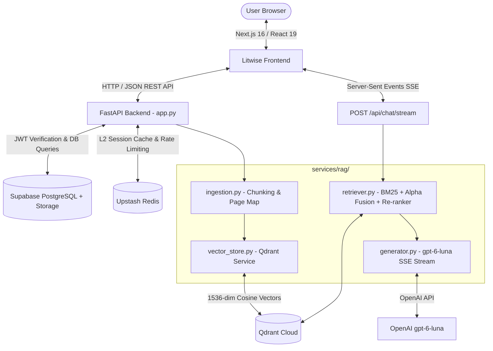

# Litwise — System Architecture & Technical Specifications

---

## 1. High-Level Architecture Overview

Litwise is designed as a decoupled, modern multi-service system comprising:
1. **Next.js 16 Web Application** (React 19, Tailwind CSS v4, Radix UI, Zustand, TanStack Query)
2. **FastAPI Asynchronous Backend** (Python 3.13, Uvicorn, LangGraph, Qdrant Client, NLTK)
3. **Database & Storage Layer** (Supabase PostgreSQL, Qdrant Cloud Vector DB, Upstash Redis L2 Cache)
4. **AI Models & Embeddings** (OpenAI `text-embedding-3-small`, `gpt-6-luna`)



---

## 2. Technology Stack

### Frontend (`litwise-frontend`)
* **Framework**: Next.js 16.0.10 (App Router) with React 19.2.3.
* **Styling**: Tailwind CSS v4 (`@tailwindcss/postcss: ^4`) with OKLCH design tokens.
* **UI Components**: Radix UI Primitives (`@radix-ui/react-*`), Lucide Icons (`lucide-react`), Sonner toasts.
* **PDF Engine**: React PDF (`react-pdf: ^10.3.0`), `pdfjs-dist`, `@react-pdf/renderer`.
* **State & Data Fetching**: Zustand (`zustand: ^5.0.8`), TanStack React Query (`@tanstack/react-query: ^5.90.10`).
* **Rich Text Editing**: TipTap Editor (`@tiptap/react`, `@tiptap/starter-kit`, tables, mentions).
* **Animations**: Framer Motion (`framer-motion: ^12.23.24`).

### Backend (`litwise-backend`)
* **Framework**: FastAPI (Python 3.13) with Uvicorn server.
* **Orchestration**: LangGraph (`pipelines/pipeline.py`) for multi-agent background summarization.
* **Vector Store Client**: `qdrant-client` 1.16.0 connecting to Qdrant Cloud (`litwise_collection`).
* **Lexical Search**: `rank_bm25` (BM25Okapi) with `nltk` (tokenization & stopword removal).
* **PDF Extraction**: `PyPDF2` and `PyMuPDF` with custom null-byte sanitization.
* **Observability & Error Tracking**: Sentry SDK (`sentry_sdk` with FastAPI and Starlette integrations).

### Data & Cloud Infrastructure
* **Relational Database & Auth**: Supabase (PostgreSQL 15 + Row Level Security + Supabase Auth JWT).
* **Vector Database**: Qdrant Cloud (1,536 dimensions, Cosine distance metric).
* **Caching & Rate Limiting**: Upstash Redis (Serverless Redis REST client).
* **LLM & Embeddings Provider**: OpenAI API (`text-embedding-3-small` for vectors, `gpt-6-luna` for generation).

---

## 3. The Rebuilt RAG Pipeline Architecture (`services/rag/`)

To eliminate bloated AI-generated pipelines and ensure 100% interview mastery, the RAG engine is isolated into four distinct, modular files:

```
litwise-backend/services/rag/
├── ingestion.py       # Step 1.1: Document chunking & character-offset page mapping
├── vector_store.py    # Step 1.2: Qdrant client, OpenAI embeddings & isolated search
├── retriever.py       # Step 1.3: BM25 keyword search, score normalization, alpha fusion & re-ranking
├── generator.py       # Step 1.4: OpenAI gpt-6-luna streaming & citation grounding
└── test_vector_rag.py # Verification script for live end-to-end testing
```

### Module Responsibilities:

| Module | Core Classes / Functions | Primary Responsibility |
| :--- | :--- | :--- |
| **`ingestion.py`** | `DocumentChunk`, `DocumentIngestionService` | Cleans text (null bytes `\x00`), splits via `RecursiveCharacterTextSplitter`, maps character boundaries to exact PDF page numbers. |
| **`vector_store.py`** | `VectorStoreService` | Initializes `litwise_collection` (1,536 dim, Cosine), batches OpenAI embeddings with `asyncio.to_thread`, queries Qdrant with strict `paper_id` filters. |
| **`retriever.py`** | `HybridRetriever` | In-memory `BM25Okapi` index per paper, Min-Max normalization, weighted alpha fusion (`alpha * vector + (1 - alpha) * bm25`), verbatim match boost (+0.35), token overlap bonus (+0.35), prefix-hash deduplication. |
| **`generator.py`** | `ResponseGenerator` | System prompt enforcement, `gpt-6-luna` token streaming via SSE (`data: {"type": "token", "content": "..."}\n\n`), followed by citation payloads (`data: {"type": "sources", ...}\n\n`). |

---

## 4. Repository & Directory Structure

```
Litwise Project/
├── PRD.md                       # Product Requirements Document
├── ARCHITECTURE.md              # Technical Architecture & Systems Specification
├── MEMORY.md                    # Historical Progress & Implementation Log
├── DESIGN.md                    # Design System, OKLCH Tokens, Typography & Layout
├── TRACKER.md                   # Active Feature Tracker & Next Milestones
├── litwise-frontend/            # Next.js 16 Client Application
│   ├── src/
│   │   ├── app/                 # Next.js App Router Pages
│   │   │   ├── chat/            # Research Chat Interface
│   │   │   ├── upload/          # Paper Upload Page
│   │   │   ├── quiz/            # AI Comprehension Quizzes
│   │   │   ├── study-plan/      # Learning Roadmaps
│   │   │   ├── literature-review/# Multi-Paper Synthesizer
│   │   │   ├── ai-citation/     # Citation Formatter & Exporter
│   │   │   ├── research-editor/ # TipTap Rich Text Editor
│   │   │   └── globals.css      # OKLCH CSS Design Tokens & Theme Variables
│   │   ├── components/          # Reusable UI & Feature Components
│   │   │   ├── chat/            # Chat bubbles, message stream, citation tags
│   │   │   ├── reader/          # PDF viewer pane & highlight overlay
│   │   │   ├── ui/              # Radix UI wrapper primitives
│   │   │   └── ...
│   │   └── lib/                 # Supabase client, query client, utility functions
│   └── package.json
│
└── litwise-backend/             # FastAPI Python Application
    ├── app.py                   # Main FastAPI entry point & route registration
    ├── requirements.txt         # Python dependencies
    ├── services/
    │   ├── rag/                 # Rebuilt, Clean RAG Pipeline
    │   │   ├── ingestion.py     # Step 1.1: Chunking & Page Map
    │   │   ├── vector_store.py  # Step 1.2: Qdrant Vector Store
    │   │   ├── retriever.py     # Step 1.3: BM25 + Hybrid Fusion + Re-ranking
    │   │   ├── generator.py     # Step 1.4: LLM Generation (gpt-6-luna)
    │   │   └── test_vector_rag.py# Live verification script
    │   ├── message_cache_service.py # Redis L2 session message caching
    │   ├── rate_limiter_service.py  # Upstash Redis rate limiting
    │   ├── quiz_service.py      # AI Quiz generation logic
    │   └── study_plan_service.py# Study plan synthesis logic
    ├── routes/                  # API Routers
    │   ├── chat.py              # Chat sessions, history & streaming SSE
    │   ├── quiz.py              # Quiz generation & grading
    │   ├── study_plan.py        # Study plan endpoints
    │   ├── literature_review.py # Multi-paper reviews
    │   ├── citations.py         # Bibliography generation
    │   └── search.py            # Global paper search
    ├── workflow/
    │   ├── db.py                # Supabase & Qdrant Client connections
    │   └── utils.py             # Legacy PDF extraction & utilities
    └── models/                  # Pydantic schemas (chat, papers, user, etc.)
```

---

## 5. Database Schema & Data Models

### 5.1 Supabase (PostgreSQL) Tables
* **`papers`**:
  * `id (UUID, PK)`: Unique paper identifier.
  * `user_id (UUID, FK)`: Owner of the uploaded paper.
  * `title (TEXT)`: Extracted or uploaded paper title.
  * `file_url (TEXT)`: Supabase Storage public/signed URL to the PDF.
  * `summary (TEXT)`: Executive summary generated by background agent.
  * `page_count (INT)`: Number of pages.
  * `created_at (TIMESTAMPTZ)`: Upload timestamp.
* **`chat_sessions`**:
  * `id (UUID, PK)`: Session ID.
  * `paper_id (UUID, FK -> papers.id)`: Associated research paper.
  * `user_id (UUID, FK)`: Session owner.
  * `title (TEXT)`: Auto-generated conversation topic title.
  * `created_at / updated_at (TIMESTAMPTZ)`: Timestamps.
* **`chat_messages`**:
  * `id (UUID, PK)`: Message ID.
  * `session_id (UUID, FK -> chat_sessions.id)`: Session container.
  * `role (TEXT)`: `'user'` or `'assistant'`.
  * `content (TEXT)`: Raw text content or markdown.
  * `sources (JSONB)`: List of cited page references `[{"page_number": 2, "content": "..."}]`.
  * `created_at (TIMESTAMPTZ)`: Message timestamp.
* **`study_plans`**:
  * `id (UUID, PK)`, `paper_id (UUID)`, `user_id (UUID)`, `plan_data (JSONB)`.
* **`quizzes`**:
  * `id (UUID, PK)`, `paper_id (UUID)`, `user_id (UUID)`, `questions (JSONB)`.

### 5.2 Qdrant Vector Collection (`litwise_collection`)
* **Vector Configuration**: `size: 1536`, `distance: Cosine`.
* **Payload Fields**:
  * `paper_id (KEYWORD index)`: Strict filter key for data isolation.
  * `chunk_id (KEYWORD)`: Unique hash identifier for deduplication.
  * `chunk_index (INTEGER)`: Sequential chunk sequence number in the paper.
  * `page_number (INTEGER index)`: Exact PDF page number where text resides.
  * `content (TEXT)`: Sanitized text passage stored for prompt injection.

### 5.3 Upstash Redis Cache Keys
* `chat:session:{session_id}:messages`: List of cached recent chat messages.
* `rate_limit:{user_id}:{minute_timestamp}`: Sliding-window API request counts.
* `paper:ownership:{user_id}:{paper_id}`: Cached boolean for fast authorization checks.

---

## 6. End-to-End API Workflows

### 6.1 PDF Upload Flow (`POST /upload`)
1. User uploads a PDF file from Next.js client.
2. FastAPI receives `UploadFile`, validates PDF headers, and writes to a temporary file.
3. `ingestion.py` extracts text with PyPDF2, sanitizes null bytes, and tracks start/end character offsets for every page.
4. `chunk_document()` splits text into ~1000-character passages while assigning the exact page number to each chunk.
5. `vector_store.py` generates OpenAI `text-embedding-3-small` embeddings in batches of 50 and upserts points to Qdrant Cloud with `paper_id` payload filters.
6. Record created in Supabase `papers` table; background LangGraph summarizer is triggered asynchronously.
7. Backend returns JSON response: `{"paper_id": "...", "status": "completed", "page_count": 12}`.

### 6.2 Grounded Chat Streaming Flow (`POST /api/chat/stream`)
1. Frontend submits user query and session metadata.
2. Backend verifies JWT and loads recent conversational memory from Upstash Redis.
3. `retriever.py` queries Qdrant Vector search and in-memory BM25 index in parallel.
4. Min-Max normalization rescales both scores to $[0.0, 1.0]$.
5. Weighted Alpha Fusion calculates:
   $$\text{Final Score} = (0.7 \times \text{Vector Score}) + (0.3 \times \text{BM25 Score})$$
6. Re-ranking applies verbatim match boost (+0.35), token overlap bonus (+0.35), and near-duplicate prefix-hash filtering, returning top 5 relevant chunks.
7. `generator.py` injects the top chunks and conversational history into the grounded `gpt-6-luna` system prompt.
8. Server-Sent Events (SSE) stream tokens to the frontend:
   * Tokens: `data: {"type": "token", "content": "..."}\n\n`
   * Sources: `data: {"type": "sources", "sources": [{"page_number": 3, ...}]}\n\n`
9. Final assistant message and citations saved to Supabase `chat_messages` and Upstash Redis cache.
